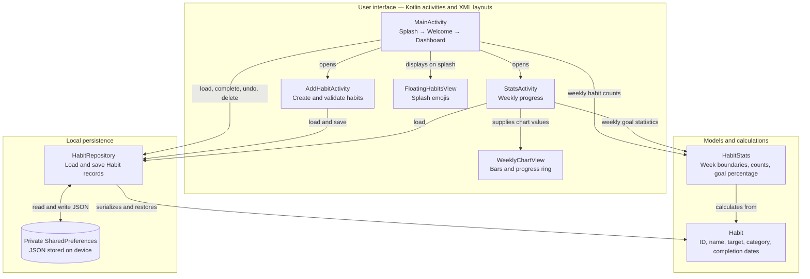

# HabitFlow

**Small habits. Lasting growth.**

HabitFlow is a native Android application that helps users build consistent routines, set weekly goals, and track their progress. The prototype stores habits and completion history locally, so its core functionality works offline.

Developed for **CS2063 — Introduction to Mobile Application Development** at the **University of New Brunswick, Fredericton**, Fall 2026.

## Team 11

- **Hadi Akbar**
- **Aryan Bansal**
- **Daniel Bradbury**

**Professor:** Howard Powell

## Features

- Home dashboard showing the current date, habits, and daily completion progress.
- Custom habits with a name, weekly target of 1–7 days, and an optional category.
- Gamification elements of built-in habits to keep you on track.
- Daily completion tracking with undo and one completion per habit per date.
- Habit deletion with confirmation before removing the habit and its history.
- Local storage for habits and completion history.
- Weekly statistics with completion counts, a bar chart, and a circular goal indicator.

**Google sign-in is planned.** The welcome screen displays the option as unavailable; authentication is not integrated.

## Architecture

HabitFlow uses a simple activity-based architecture. Activities handle user interactions and read or save `Habit` records through `HabitRepository`. Weekly calculations live in `HabitStats`, while custom Views draw the charts and splash decorations.

All core data stays on the device. Google sign-in is not part of the current architecture; its welcome-screen option is reserved for a future integration.

## Planned improvements

- Google sign-in
- Predefined habits
- Reminders and notifications
- Step tracking
- Focus timer
- Gamification and expanded analytics

These features are outside the current prototype implementation.
